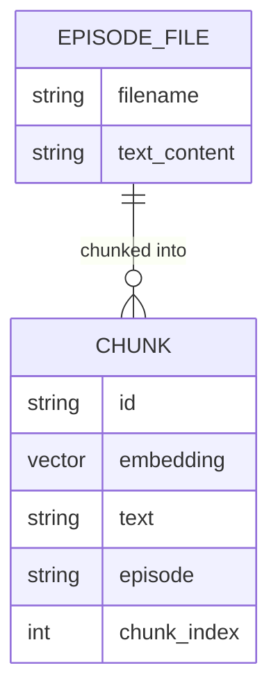

# ERD — Lenny-RAG

## Entities

### Chunk
The only stored entity. Each row is one ~500-token segment of a transcript episode, embedded and stored in ChromaDB.

| Field | Type | Notes |
|-------|------|-------|
| id | string | `{episode_slug}_{chunk_index}` — used for idempotency checks |
| embedding | vector[1024] | Voyage `voyage-2` output |
| text | string | Raw chunk text, ~500 tokens with 50-token overlap |
| episode | string | Episode filename (used as citation label) |
| chunk_index | int | Position of this chunk within its episode |

No relational database. ChromaDB handles all storage, indexing, and similarity search.

## Relationships
| Entity A | Relationship | Entity B | Notes |
|----------|-------------|----------|-------|
| Episode (file) | has many | Chunks | One transcript → N chunks via sliding window |

Episodes are not stored as entities — they exist only as source files on disk and as metadata on chunks.

## Mermaid Diagram

## Design Decisions
- **No relational DB** — ChromaDB's document store is sufficient; a separate SQL layer would add complexity with no benefit at this scale
- **ID as `{episode_slug}_{chunk_index}`** — enables idempotent ingestion: if the ID already exists in ChromaDB, skip re-embedding
- **Metadata on chunks, not a lookup table** — episode name travels with each chunk so retrieval results are self-contained; no join needed at query time
- **Voyage `voyage-2`** — 1024-dimension embeddings, good quality/cost balance, within free tier for ~300 episodes
