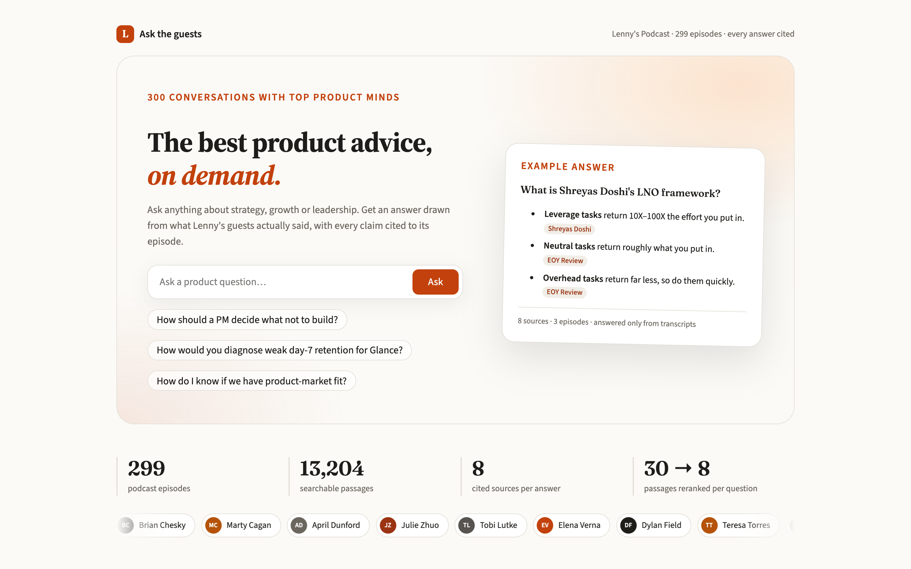
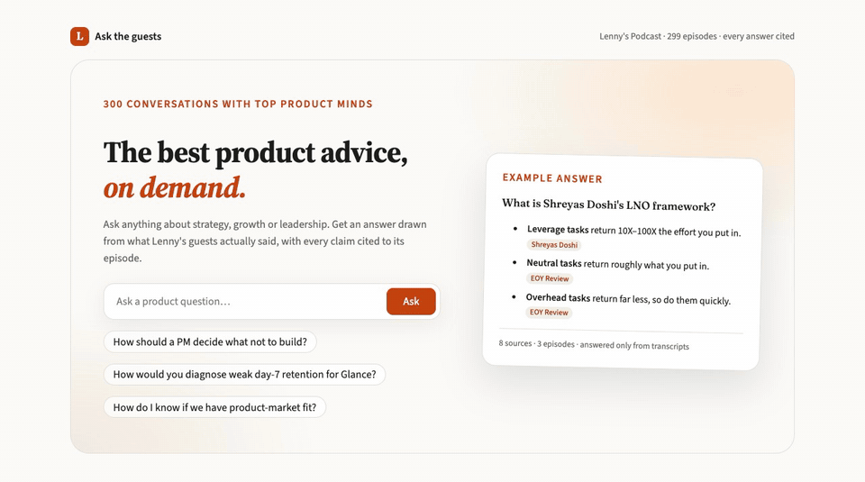
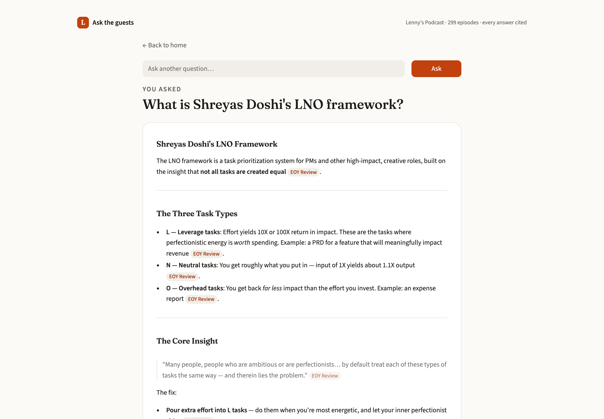
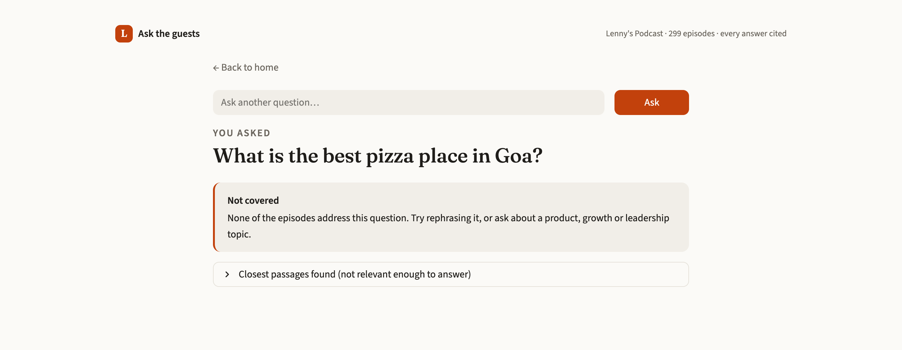
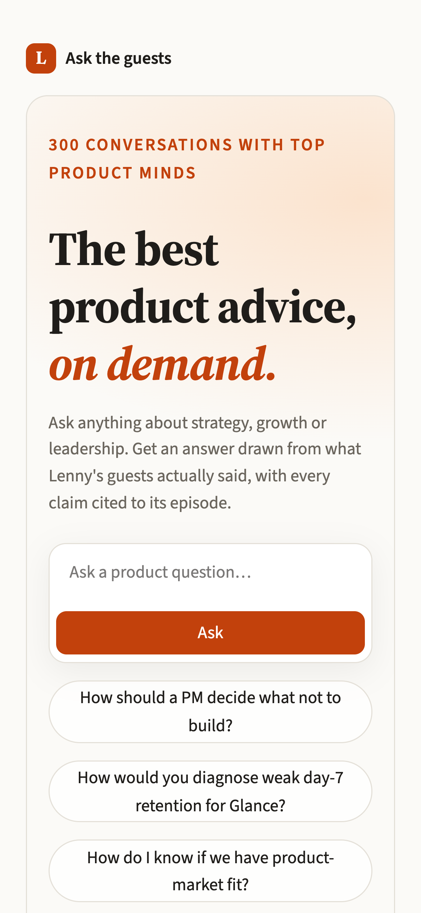

# Lenny-RAG

A retrieval-augmented generation (RAG) tool that lets me ask natural-language product strategy questions against ~300 episodes of Lenny's Podcast — and get an answer grounded in what the guests actually said, with episode citations, instead of a generic LLM guess.



## See it in action



*The wait while Claude writes the answer is sped up in this recording. [Higher-quality video](docs/screenshots/demo.mp4).*

| Answer with citations | When the podcast doesn't cover it | On a phone |
|---|---|---|
|  |  |  |

Every claim carries its episode as a citation pill. Off-topic questions get an honest "not covered" instead of a made-up answer. [Full landing page](docs/screenshots/landing-full.png).

## The problem

Lenny's Podcast has hundreds of hours of high-signal product thinking from top PMs and founders, but that knowledge is practically inaccessible day-to-day: re-listening isn't feasible, there's no search, and generic Google results don't surface episode-specific insight. The frameworks that would actually help during a strategy review or a product diagnosis go unused because there's no fast way to find them.

## How it works

1. **Ingestion** (`ingest.py`) — chunks each transcript into ~500-token windows with 50-token overlap (so an idea doesn't get split mid-thought), folding any short leftover at the end of a transcript into the previous chunk. Each chunk is embedded with Voyage AI and stored in a local ChromaDB collection (13,204 chunks). Ingestion is idempotent — it checks chunk IDs before embedding, so re-running never wastes API spend re-embedding what's already there. A `--test` flag ingests 5 transcripts first as a cost-safe dry run before committing to the full ~300.
2. **Retrieval** (`rag.py`) — two stages: embeds the question and pulls the 30 most similar chunks from ChromaDB, then a Voyage reranker reads the question next to each candidate and keeps the 8 that actually answer it.
3. **Generation** (`rag.py`) — sends the retrieved chunks to Claude with a system prompt that restricts it to answering *only* from the provided excerpts, forces inline `[Episode Name]` citations on every claim, and requires it to say plainly when the transcripts don't cover the question rather than improvise.
4. **Interfaces** — a CLI (`query.py`) for fast iteration, and a Streamlit web app (`app.py`): a landing page with the ask box, example questions and framework cards, and a focused results view with citation pills and the retrieved sources in a collapsible panel for verification.

## Measuring retrieval

`eval/` holds a golden set of 40 questions, each tagged with the episodes that answer it (checked against the transcript text), and a script that scores retrieval with and without reranking:

| | Right episode at #1 | In top 3 | In top 8 | MRR |
|---|---|---|---|---|
| Vector search only | 28/40 | 34/40 | 40/40 | 0.80 |
| + reranking | **33/40** | **39/40** | 40/40 | **0.90** |

Every change is measured before it ships and recorded in the [changelog](./CHANGELOG.md), including what didn't work.

## Why this is a good example of my product work

This was scoped like a real feature, not a script: a [PRD](./PRD.md) with a specific user and success metrics, a [design brief](./DESIGN.md) for the UX, an [ERD](./ERD.md) for the ChromaDB data model, and a [technical brief](./PROJECT_BRIEF.md) that pinned down chunking strategy, retrieval config, and cost estimates before writing code. The build decisions reflect product judgment as much as engineering — grounding-only answers over fluent-but-wrong ones, a cost guard before a $0.30 ingestion run, honest "not covered" responses over hallucinated confidence.

## Tech stack

- **Embeddings:** Voyage AI (`voyage-3.5`)
- **Reranking:** Voyage AI (`rerank-2.5`)
- **Vector store:** ChromaDB (local, persisted to disk)
- **Generation:** Claude API (Sonnet)
- **UI:** Streamlit
- **Tokenization:** tiktoken (`cl100k_base`) for chunk sizing

## Running it locally

```bash
python -m venv venv && source venv/bin/activate
pip install -r requirements.txt
cp .env.template .env  # add ANTHROPIC_API_KEY and VOYAGE_API_KEY

# Point TRANSCRIPTS_DIR (see .env.template) at your own transcript corpus —
# the Lenny's Podcast transcripts used here aren't included in this repo.

python ingest.py --test   # verify the pipeline on 5 transcripts first
python ingest.py          # full ingestion

python query.py "How do top PMs think about retention?"
# or
streamlit run app.py
```

> The transcript corpus itself isn't included in this repo — redistributing ~300 full podcast transcripts publicly isn't something I have rights to do. This repo is the pipeline and product thinking, not the underlying content.

## More documentation

- [PRD.md](./PRD.md) — problem statement, user stories, scope
- [DESIGN.md](./DESIGN.md) — UX principles, user flows, component inventory
- [ERD.md](./ERD.md) — ChromaDB data model
- [PROJECT_BRIEF.md](./PROJECT_BRIEF.md) — chunking strategy, retrieval config, cost estimates
- [CHANGELOG.md](./CHANGELOG.md) — every change, why it was made, and what was measured
